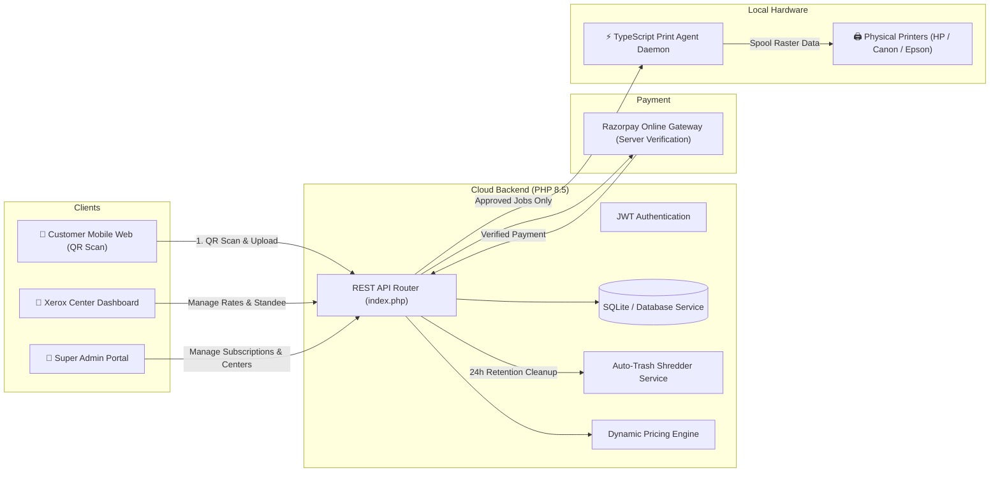

# SmartPrint — Xerox Center Management System & Micro-Print Engine

> **Actual Process Architecture** derived from the SmartPrint System Flowchart:
> Super Admin &rarr; Xerox Center &rarr; Customer &rarr; Local Print Agent &rarr; Physical Printer

---

## 🏗️ System Architecture



---

## 📂 Enterprise Monorepo Directory Structure

```
SmartPrintSystem/
├── backend/                         # Enterprise PHP 8.5 REST API
│   ├── config/
│   │   ├── app.php                  # App configuration & JWT TTL
│   │   └── database.php             # SQLite & fallback storage paths
│   ├── public/
│   │   └── index.php                # Front controller & REST router
│   ├── src/
│   │   ├── Controllers/
│   │   │   ├── AuthController.php          # Sign-in, Register, Profile, Passwords
│   │   │   ├── SuperAdminController.php    # Platform KPIs, Directory, Subscriptions
│   │   │   ├── XeroxCenterController.php   # Dashboard, Standee QR, Rates, Printers, Queue
│   │   │   ├── CustomerPrintController.php # 8-Step Printing Journey
│   │   │   └── PrintAgentController.php    # Handshake, Polling, Telemetry
│   │   ├── Middleware/
│   │   │   ├── CorsMiddleware.php          # Cross-Origin resource sharing
│   │   │   └── AuthMiddleware.php          # JWT verification & RBAC
│   │   └── Services/
│   │       ├── DatabaseService.php         # SQLite PDO + JSON fallback + Auto Seeder
│   │       ├── AuthService.php             # HMAC-SHA256 JWT provider
│   │       ├── PricingService.php          # B/W, Color, Duplex, Paper Surcharges
│   │       └── AutoTrashService.php        # 24h Privacy document shredder
│   ├── storage/
│   │   ├── db/smartprint.sqlite            # Embedded database
│   │   └── uploads/                        # Private encrypted document vault
│   ├── php.ini                             # Self-contained Windows PHP configuration
│   └── run.bat                             # Launches API on http://127.0.0.1:8000
│
├── frontend/                        # TypeScript + React 19 + Tailwind v4
│   ├── src/
│   │   ├── components/
│   │   │   ├── common/
│   │   │   │   ├── HeaderNav.tsx           # Glassmorphic navbar with active view switcher
│   │   │   │   └── LoginModal.tsx          # 1-Click quick login & vendor registration
│   │   │   ├── customer/
│   │   │   │   └── CustomerFlow.tsx        # Complete 8-step printing flow from PDF
│   │   │   ├── center/
│   │   │   │   └── CenterView.tsx          # Vendor hub, QR Standee designer, Queue, Analytics
│   │   │   ├── superadmin/
│   │   │   │   └── SuperAdminView.tsx      # Multi-tenant oversight, Subscriptions, Directory
│   │   │   └── agent/
│   │   │       └── AgentConsoleView.tsx    # Live hardware Print Agent simulator
│   │   ├── contexts/
│   │   │   └── AuthContext.tsx             # Role-based context & demo accounts
│   │   ├── services/
│   │   │   └── api.ts                      # Type-safe client for all API routes
│   │   ├── types/
│   │   │   └── index.ts                    # Strict TypeScript data models
│   │   ├── index.css                       # Corporate White Liquid Crystal Glassmorphism theme
│   │   ├── App.tsx
│   │   └── main.tsx
│   ├── vite.config.ts                      # Vite config with API proxy
│   └── package.json
│
├── print-agent/                     # Standalone Local Print Agent Daemon (TypeScript)
│   ├── src/
│   │   └── agent.ts                        # Agent handshake, queue polling, hardware spooling
│   ├── dist/agent.js                       # Compiled Node.js runtime
│   ├── tsconfig.json
│   ├── package.json
│   └── run.bat
│
├── start-system.bat                 # 1-Click Launch for all services
├── start-system.ps1                 # PowerShell launcher
└── README.md
```

---

## 🎨 Liquid Crystal Corporate White Theme
The UI uses an enterprise **Liquid Crystal Corporate White Glassmorphism** design system:
- High-refraction frosted glass cards (`backdrop-blur-2xl`, `bg-white/80`, ultra-crisp white crystal borders `border-white/90`).
- Pearlescent opalescent highlights with dynamic shimmer animations (`liquid-crystal-sheen`).
- High readability slate typography (`#0f172a`), emerald active status badges, and electric blue accents.

---

## 🔄 The 8-Step Customer Journey (Page 2 of PDF)

1. **01 • QR SCAN**: Customer scans the Xerox Center unique QR code or selects a center (`XC-89412`).
2. **02 • CENTER DASHBOARD**: Center profile, available paper types, printer capabilities, and queue wait times load.
3. **03 • DOCUMENT SELECTION**: Drag-and-drop file upload with simulated lossless compression (saving ~55% size) and automatic page detection.
4. **04 • PRINT SETTINGS**: Select page range, copies, B/W vs Color, paper size (A4, A3, Legal, Letter), and Duplex (Single vs Double-sided). Real-time price updates dynamically.
5. **05 • PAYMENT**: Razorpay simulation supporting UPI (GPay/PhonePe), Card, or NetBanking with instant cryptographic signature verification.
6. **06 • PRINT QUEUE**: Verified job enters the center queue; customer receives a unique 4-digit PIN / Job Token (e.g. `SP-8421`).
7. **07 • PHYSICAL PRINT**: Local Print Agent receives the approved job and spools pages to the physical printer.
8. **08 • HISTORY + AUTO TRASH**: Digital tax invoice receipt issued; document is tagged for automated shredding after the 24-hour retention window.

---

## 🔑 Demo Access Credentials

| Role | Email | Password | Features |
|---|---|---|---|
| **Super Admin** | `admin@smartprint.com` | `admin123` | Multi-center directory, Subscription plans setup, Platform financials |
| **Xerox Vendor 1** | `center@quickprint.com` | `center123` | Center `XC-89412`, Live queue, Acrylic QR standee, Printers rate card |
| **Xerox Vendor 2** | `delhi@apexprint.in` | `center123` | Center `XC-44218`, Engineering college station, Separate queue |
| **Walk-in Customer** | *No account required* | — | 8-step scan-to-print self-service experience |

*(Use the **1-Click Instant Demo Login** buttons inside the Sign In modal for zero-typing access!)*

---

## 🚀 How to Run the System

### Option A: 1-Click Unified Launcher (Windows)
Double-click `start-system.bat` or run:
```powershell
.\start-system.ps1
```
This automatically boots:
1. PHP API on `http://127.0.0.1:8000`
2. Frontend Vite Dev Server on `http://localhost:5173`
3. Local Print Agent Daemon polling the backend

---

### Option B: Individual Service Launch

#### 1. Backend (PHP 8.5)
```bash
cd backend
php -c php.ini -S 127.0.0.1:8000 -t public
```

#### 2. Frontend (TypeScript / React / Vite)
```bash
cd frontend
npm run dev
```

#### 3. Print Agent (TypeScript Daemon)
```bash
cd print-agent
node dist/agent.js
```

---

## ⚡ Deploying to Vercel (Production)

The repository is pre-configured with `vercel.json`, root `package.json`, and serverless API handlers in `api/`.

### 1-Click Web Deployment:
1. Go to [Vercel New Project](https://vercel.com/new).
2. Import the GitHub repository: `Suyash-coder-12/SmartPrintSystem.IdeaLab`.
3. Keep default settings (`Root Directory: ./`, build command is automatic via `vercel.json`).
4. Click **Deploy**.

### CLI Deployment:
```bash
npx vercel --prod
```

